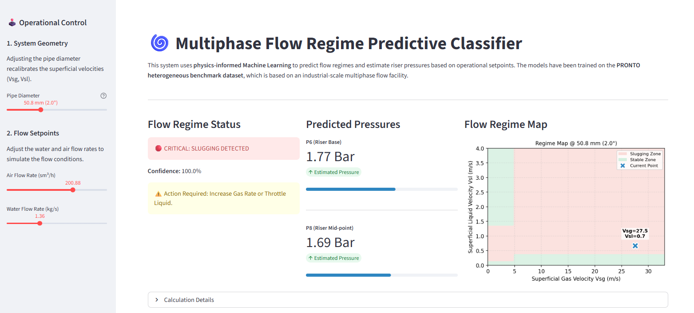
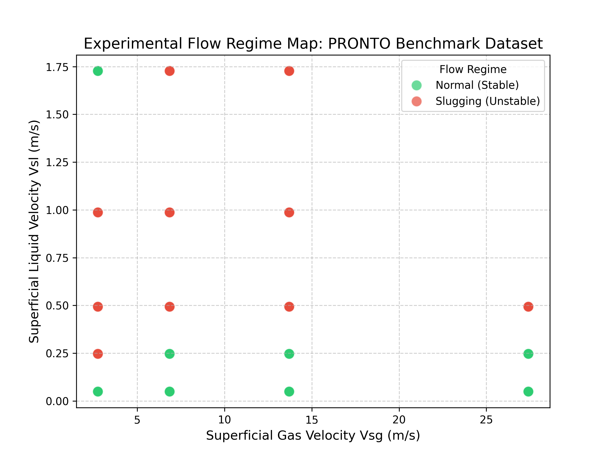
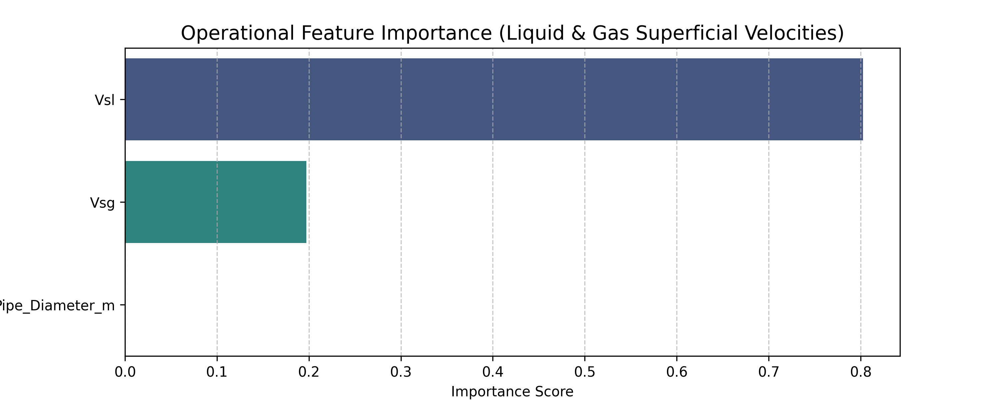
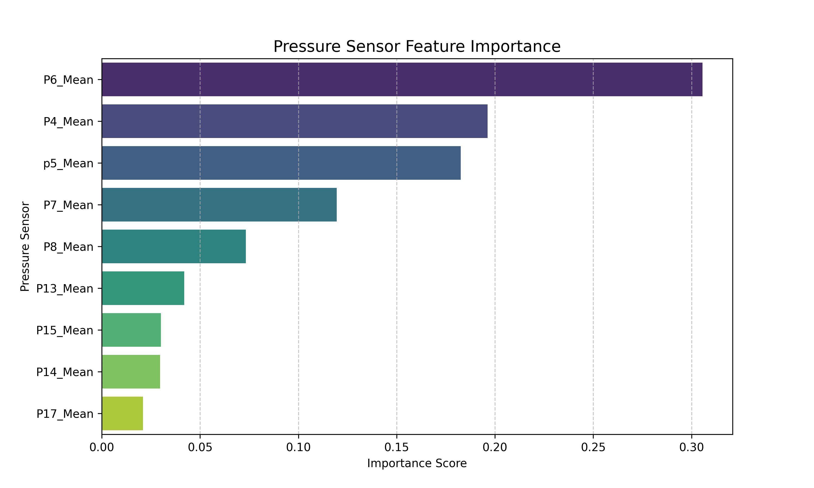

# Multiphase Flow Regime Classification & Pressure Forecasting

[Link to Live Multiphase Classifier App 🌀:](https://www.google.com/search?q=https://your-streamlit-app-link.herokuapp.com/)

<p align="center">

</p>

This project implements a physics-informed predictive framework for industrial pipeline monitoring. Utilizing a dual **Random Forest** architecture, the system classifies flow regimes and forecasts riser pressures with high precision. The **classifier model achieves 100% accuracy** and the regression models achieve **R² Scores of 0.970 and 0.984**, providing operators with a high-fidelity system for real-time flow assurance and hydraulic systems optimization.


## 📌 Project Overview

Flow instabilities, such as slugging, pose significant risks to pipeline integrity and processing efficiency in multiphase industries. Sudden pressure surges can damage equipment and cause unplanned shutdowns.

This project addresses these challenges by developing a comprehensive diagnostic engine that analyzes high-frequency pressure sensor data to identify flow regimes and predict backpressure changes before they impact operations.

## 🛠️ Technology Used

* **Machine Learning:** Scikit-learn (Random Forest, Logistic Regression)
* **Web Framework:** Streamlit
* **Data Science:** Pandas, NumPy, Joblib
* **Visualization:** Matplotlib, Seaborn
* **Dataset:** [PRONTO Benchmark Dataset (Cranfield University)](https://doi.org/10.1016/j.jprocont.2019.04.009) - can also be accessed on [Kaggle](https://www.kaggle.com/datasets/afrniomelo/pronto-benchmark)

## 🔳 Key Features

* **Physics-Informed Feature Engineering:** Transforms raw flow rates into area-normalized **Superficial Velocities ()**, ensuring the model's logic is geometry-independent.
* **Statistical Windowing:** Processes 5kHz high-frequency data using a **250ms rolling window** to ensure statistical stationarity and filter out random sensor noise.
* **Dual-Mode Architecture:** Features a **Classifier** for regime detection (Stable vs. Slugging) and a **Regressor** for pressure estimation at key riser locations (P6, P8).
* **Flow Regime Mapping:** An interactive Streamlit dashboard that visualizes the current operating point against a dynamic flow regime map.

## 📁 Repository Structure

<pre>
├── data
│   ├── Test9_high_frequency_pressure 
│   ├── Test10_high_frequency_pressure
│   └── processed_data.csv
├── data_preprocessing
│   ├── data_preprocessing.ipynb
├── image_assets
│   ├── dashboard_preview.png
│   ├── flowpipe.png
├── model_assets
│   ├── models_assets.pkl        
├── model_training
│   ├── model_training.ipynb
├── results
│   ├── feature_importance_pressure_sensors.png
│   ├── feature_importance_superficial_velocities.png
│   ├── flow_regime_map.png
│   └── pressure_sensors_distribution.png
├── streamlit_app
│   ├── multiphase_flow_classifier.py                   
├── LICENSE
├── README.md
└── requirements.txt
</pre>

## 🚀 Getting Started

### 1. Clone the Repository

```bash
git clone https://github.com/Oluwatobi-coder/Multiphase-Flow-Classifier.git
cd Multiphase-Flow-Classifier

```

### 2. Install Dependencies

```bash
pip install -r requirements.txt

```

### 3. Run the App

```bash
streamlit run ./streamlit_app/multiphase_flow_classifier.py

```


### 4. Run the data preprocessing and model training files (Optional)

* Download and extract the `Test9_high_frequency_pressure` and `Test10_high_frequency_pressure` folders from the following [folder](https://drive.google.com/drive/folders/15Al4DJQSQWvKx6NU-cynq0rQ380sK20M?usp=sharing) 

* Ensure both folders are placed in the `data` directory

* Run the cells in the `data_preprocessing/data_preprocessing.ipynb` and `model_training/model_training.ipynb` files.


## 📊 Results

The Random Forest models demonstrated near-perfect performance, successfully capturing the non-linear boundaries of multiphase flow regimes and pressure fluctuations.

<p align="center">

</p>

| Metric | Classifier Performance | Regressor (P6) Performance | Regressor (P8) Performance |
| --- | --- | --- | --- |
| **Accuracy Score** | 100.00% | - | - |
| **R² Score** | - | 0.984 | 0.970 |
| **RMSE (barg)** | - | 0.0553 | 0.0672 |

### Performance Insights

<p align="center">


</p>

* **Primary Driver:** Superficial Liquid Velocity ($V_{sl}$) was identified as the dominant factor in regime transitions.
* **Pressure Effects:** Pressure sensors **P6** (Riser Base)  and **P8** (Riser Mid-Section) were determined to be the most influential indicators in monitoring flow stability.

## 🤝 Contributing

Contributions are welcome! Potential improvements include:

* Expanding the dataset to include oil-water-gas three-phase flow.
* Integrating an LSTM layer to capture long-term temporal trends in pressure buildup.


## 📚 References

* Stief, A., Tan, R., Cao, Y., Ottewill, J. R., Thornhill, N. F., & Baranowski, J. (2019). A heterogeneous benchmark dataset for data analytics: Multiphase flow facility case study. *Journal of Process Control*, 79, 41–55. https://doi.org/10.1016/j.jprocont.2019.04.009

## 📜 License

This project is licensed under the MIT License - see the `LICENSE` file for details.

If you find this Classifier Framework useful, please ⭐ the repository!


# Short-Term Wind Power Forecasting using LSTM Networks

[Link to Live App ⚡:]()

<p align="center">

</p>

This project implements a predictive modelling framework for wind energy grid integration. Utilizing a layered **Long Short-Term Memory (LSTM)** neural network, the system models the non-linear relationship between weather data and power output. The model achieves an **R² Score of 0.9989** and an **RMSE of 0.0099**, providing grid operators with a high-fidelity Digital Twin for real-time frequency regulation and ramp event management.

## 📌 Project Overview

Wind energy intermittency presents a significant challenge for grid stability. Sudden changes in wind speed (ramp events) can lead to frequency deviations if backup generation is not dispatched in time.

This project addresses this by developing a robust forecasting engine that analyzes weather data and historical power output to forecast future wind turbine power generation.

## 🛠️ Technology Used

* **Deep Learning:** TensorFlow/Keras
* **Web Framework:** Streamlit (Real-time Dashboard)
* **Data Science:** Pandas, NumPy, Scikit-learn
* **Visualization:** Plotly (Interactive Graphs), Matplotlib (Analysis)
* **Dataset:** [Kaggle Wind Power Generation Data](https://www.kaggle.com/datasets/mubashirrahim/wind-power-generation-data-forecasting)

## 🔳 Key Features

* **Stacked LSTM Architecture:** Features 64 Encoder units and 32 Decoder units with Dropout regularization (0.2) to capture complex temporal dependencies.
* **Automated Training Supervision:** Implements `EarlyStopping` with weight restoration to ensure the model generalizes effectively without overfitting.
* **Interactive Simulation Slider:** A custom Streamlit control station that allows users to scroll through Operational Days and adjust Lookahead Horizons.
* **Grid Dispatch Insights:** An automated logic engine that provides operational alerts (e.g., "Pre-charge battery storage") based on forecast volatility and average power output.

## 📁 Repository Structure

<pre>
├── data
│   └── Location1.csv
├── model_assets
│   ├── feature_cols.pkl
│   ├── scaler.gz
│   ├── test_data.csv
│   └── wind_lstm_model.keras
├── model_training
│   ├── wind_power_forecasting_lstm.ipynb
├── results
│   ├── dashboard_preview.png
│   ├── forecast_vs_actual.png
│   ├── model_convergence.png
│   ├── power_curve.png
│   └── wind_speed_comparison.png
├── streamlit_app
│   ├── wind_power_pred.py
├── LICENSE
├── README.md
└── requirements.txt
</pre>

## 🚀 Getting Started

### 1. Clone the Repository

```bash
git clone https://github.com/Oluwatobi-coder/Wind-Power-Forecasting-LSTM.git
cd Wind-Power-Forecasting-LSTM

```

### 2. Install Dependencies

```bash
pip install -r requirements.txt

```

### 3. Run the App

```bash
streamlit run ./streamlit_app/wind_power_pred.py

```

## 📊 Results

The LSTM model demonstrated near-perfect alignment with simulated ground-truth data, successfully identifying both daily cycles and random wind gusts.

<p align="center">

</p>

<p align="center">

</p>


| Metric | Test Set Performance |
| --- | --- |
| **Root Mean Square Error (RMSE)** | 0.0099 |
| **Mean Absolute Error (MAE)** | 0.0061 |
| **R² Score (Variance Explained)** | 0.9989 |

### Performance Visualizations


## 🤝 Contributing

Contributions are welcome! Potential improvements include:

* Adding Multi-Site forecasting (Offshore vs. Onshore).
* Implementing a PID controller simulation for blade pitch control based on the forecast.


## 📚 References

* Hochreiter, S., & Schmidhuber, J. (1997). Long Short-Term Memory. Neural Computation, 9(8), 1735–1780. 10.1162/neco.1997.9.8.1735.
* Rahim, M. (2021). Wind Power Generation Data Forecasting. Kaggle. Available at: https://www.kaggle.com/datasets/mubashirrahim/wind-power-generation-data-forecasting


## 📜 License

This project is licensed under the MIT License - see the `LICENSE` file for details.

If you find this simulation framework useful, please ⭐ the repository!